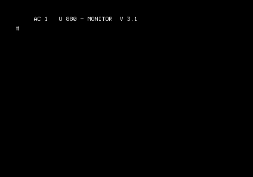

[Deutsch](https://github.com/haykonus/AC1-Demos) | [English](https://github-com.translate.goog/haykonus/AC1-Demos?_x_tr_sl=de&_x_tr_tl=en&_x_tr_hl=de&_x_tr_pto=wapp)
# INHALT

[ASCII-Lines für AC1](https://github.com/haykonus/AC1-Demos/blob/main/README.md#ascii-lines-f%C3%BCr-AC1)

 

# ASCII-Lines für AC1

ASCII-Lines für AC1 ala MS Screensaver. Original von V. Pohlers/M. Leubner für den Hübler-Grafik-MC. 

Tasten: 

       "+" -> mehr Linien
       
       "-" -> weniger Linien
       
       "H" -> hor. Spiegelung ein/aus
       
       "V" -> vert. Spiegelung ein/aus
       
       sonst:  Ende

Zum Assemblieren wurde der [Arnold-Assembler](http://john.ccac.rwth-aachen.de:8000/as/) unter Windows 11 verwendet.

## Voraussetzungen

- AC1 (ACC,SCCH,2010,...)
- oder [JKCEMU](http://www.jens-mueller.org/jkcemu/index.html)
- min. 1KB BWS, 1KB RAM

## Schnellstart
> [!NOTE]
> Die Links unten anklicken und danach den Download-Button (Download raw file) im Github klicken, um die Datei zu laden.

- [lines.bin](https://github.com/haykonus/AC1-Demos/blob/main/ASCII-Lines/lines.bin) auf Adresse 1880H laden.
  
Starten mit:
- I (nur beim Ur-AC1 notwendig) 
- J 1880
  
## Quellen

Dieses Projekt nutzt Infos und Software aus folgenden Quellen:

[1] https://hc-ddr.hucki.net/wiki/doku.php/homecomputer/hueblergrafik#downloads
